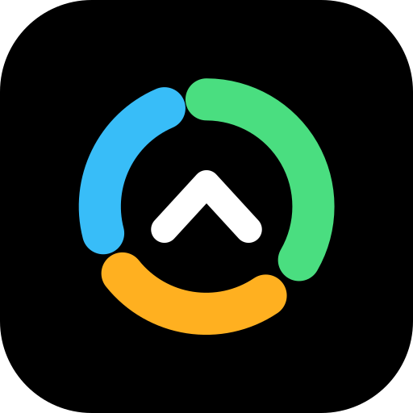
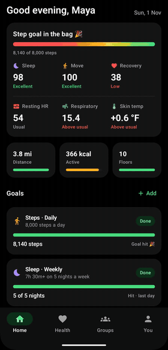
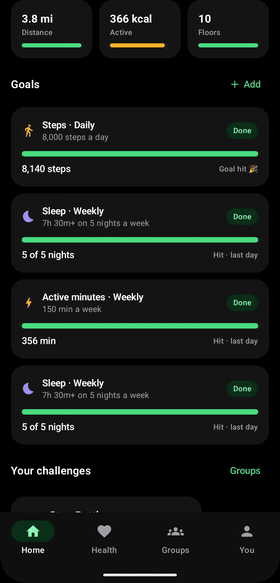
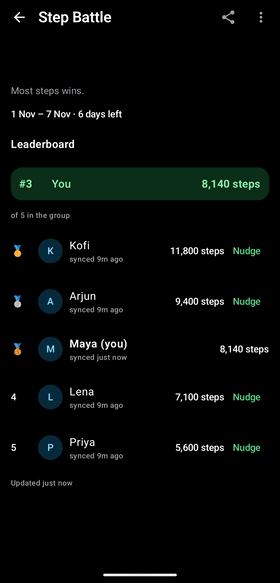
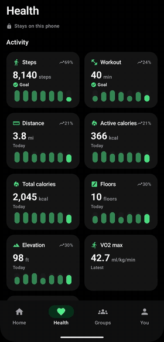
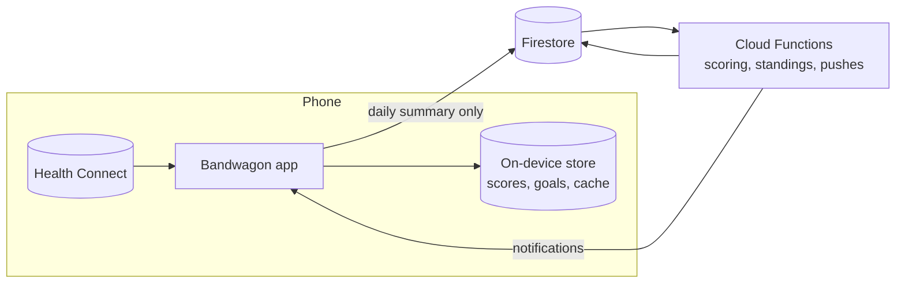

<p align="center">
  
</p>

<h1 align="center">Bandwagon</h1>

<p align="center">
  <b>Get healthier together.</b><br>
  Challenges, team goals and sleep pacts with friends, powered by the health data already on your phone.
</p>

<p align="center">
  <a href="https://github.com/prat31/bandwagon-fit/actions/workflows/ci.yml"></a>
  <a href="LICENSE"></a>
  
  
  
  <a href="CONTRIBUTING.md"></a>
</p>

<p align="center">
  <a href="https://play.google.com/store/apps/details?id=fit.bandwagon">
    
  </a>
</p>

<table align="center">
  <tr>
    <td align="center"><br><sub><b>Home</b>: your day at a glance</sub></td>
    <td align="center"><br><sub><b>Goals</b>: daily, weekly, monthly</sub></td>
    <td align="center"><br><sub><b>Challenges</b>: friendly competition</sub></td>
    <td align="center"><br><sub><b>Health</b>: every metric, one place</sub></td>
  </tr>
</table>

---

## Why Bandwagon

Most health apps are a solo grind. Bandwagon turns your data into small social loops that keep you
going: race friends on steps, chip away at a team goal together, or keep a bedtime pact with
your partner.

- **Works with whatever you wear.** Data comes from **Health Connect**, so any phone, watch, ring or
  scale that writes there just works. No accounts to link, no vendor lock-in.
- **Your health data stays on your phone.** Only a short daily summary (steps, minutes, sleep time)
  syncs, and groups see only what their challenges use. Heart, vitals, body and nutrition never
  leave the device.
- **Free and open source.** No ads, no tracking SDKs, MIT licensed.

## Features

| | |
|---|---|
| 🏠 **Home** | Steps-to-goal bar that warms from red to green, a **sleep score** and **move score** (0–100, every point explained), recovery vs your usual, resting heart rate, breathing rate and skin temperature |
| 🎯 **Goals** | Personal daily, weekly or monthly goals for steps, distance, sleep, workouts, scores and more, including "on N days" goals. Streaks, pace, and history that's re-checked when a device syncs late |
| 👥 **Groups** | Named or anonymous groups, public or invite-only, invite links and usernames, owners and mods, an activity feed with emoji reactions |
| 🏆 **Challenges** | 15+ templates: step battles, team distance, boss battles, sleep pacts, workout streaks, plus fully custom rules. Fair by design: manual entries don't count, every day is in each member's own time zone |
| ❤️ **Health** | 30+ Health Connect metrics with daily, weekly, monthly and yearly charts, your personal normal range, sleep stages and workouts |
| 🔔 **Notifications** | Six kinds, each with its own switch, plus quiet hours |
| 🔒 **Privacy** | Download all your data as JSON, delete your account in the app, nothing sold, nothing shared outside your groups |

## How it works



- The app reads Health Connect, computes everything personal (scores, goals, insights) on the
  device, and uploads one summary per day with only the challenge metrics.
- Cloud Functions are the only writers of group data: membership, standings and leaderboards.
  Firestore security rules keep every user's daily data private to them.
- Challenge rules are a small JSON spec evaluated by the same engine on both sides: pure Kotlin
  in `core/model` and pure TypeScript in `functions/src/domain`, checked against shared golden
  fixtures in `shared/`.

## Getting started

You don't need a Firebase account: dev builds run against the local Firebase emulators.

**You'll need:** JDK 17 (app), JDK 21 (Firebase emulators), Node.js 22, and the Android SDK or
Android Studio. `make doctor` checks all of it.

```bash
git clone https://github.com/prat31/bandwagon-fit.git && cd bandwagon-fit
make setup              # one-time: SDK packages and an emulator with Health Connect
make functions-install  # Cloud Functions dependencies
```

Then, in two terminals:

```bash
make functions-serve    # Firebase emulators: auth, Firestore, functions, storage
```

```bash
make emulator           # boot the Android emulator
make run                # build, install and launch the dev app
make seeder-run         # optional: fill Health Connect with 45 days of realistic data
```

Dev builds offer **Sign in as test user** instead of Google. To try groups on your own, add fake
members to a group from its invite code:

```bash
make fake-member CODE=ABC234 NAME=Arjun STEPS=9400 SLEEP=7.2 BEDTIME=22:50
```

On a physical phone, point the build at your computer: `make run EMULATOR_HOST=<your computer's IP>`.
`make help` lists every task.

## Project layout

```
app/                  Application, navigation, Firebase setup
core/model/           Pure Kotlin: models, challenge engine, scores, goals, insights (JVM tests)
core/health/          Health Connect boundary (HealthDataSource) and local cache
core/data/            Room, Firestore, repositories
core/sync/            Background sync with WorkManager
core/ui/              Theme (AMOLED black + bright accents), components, charts
core/notifications/   Push notifications
feature/home/         Home tab: today, scores, vitals, goals, challenges, insights
feature/health/       Health tab and metric detail screens
feature/groups/       Groups, invites, members, feed
feature/challenges/   Challenge templates, creation, leaderboards
feature/you/          Profile, preferences, notifications, privacy
feature/onboarding/   Sign-in and setup
functions/            Cloud Functions (TypeScript) and their tests
shared/               Challenge templates and golden fixtures used by both sides
tools/hc-seeder/      Debug app that writes Health Connect test data
web/                  Invite links, privacy policy, terms
```

Health reads sit behind `core/health/HealthDataSource` and business rules have no Android imports,
so an iOS (HealthKit) client can reuse them later.

## Testing

```bash
make test                  # all JVM unit tests (rules, scores, goals, mappers)
make functions-test        # Cloud Functions domain rules
make functions-group-test  # groups end to end: invites, roles, bans, leaving, races (JDK 21)
make functions-rules-test  # Firestore security rules (JDK 21)
make lint
```

## Releasing to Google Play

1. Fetch each flavour's Firebase config into `app/src/<dev|prod>/google-services.json` (git-ignored).
2. Create the **upload** key once and keep it (and its password) outside the repo, backed up:
   `keytool -genkeypair -v -keystore ~/keys/bandwagon-upload.jks -alias upload -keyalg RSA -keysize 4096 -validity 10000`.
   Copy `keystore.properties.example` to `keystore.properties` and point it at the key (or set
   `BANDWAGON_STOREFILE`, `BANDWAGON_STOREPASSWORD`, `BANDWAGON_KEYALIAS` and
   `BANDWAGON_KEYPASSWORD` in CI). Play App Signing holds the app signing key.
3. Build the bundle with a `versionCode` higher than the last upload:
   `make bundle VERSION_CODE=2 VERSION_NAME=0.1.1`. `make check-alignment` confirms the native
   libraries meet Play's 16 KB page size rule.
4. Deploy the backend: `firebase deploy --only firestore,storage,functions --project prod`. The
   pages in `web/` (privacy, terms, account deletion, invite links, `assetlinks.json`) ship with the
   bandwagon.fit site through GitHub Pages.
5. After the first upload, copy the **app signing** and **upload** certificate fingerprints from
   *Play Console → Test and release → App integrity*: SHA-1 and SHA-256 of both into the Android app
   in Firebase (then re-download `google-services.json`, or Google sign-in fails on Play installs),
   and both SHA-256 values into `web/.well-known/assetlinks.json` for invite links.
6. In Play Console, complete the Health Connect declaration and the Data safety form from the
   [privacy policy](web/privacy.html). The requested health types are `HealthDataType.REQUESTED`
   (`core/model`), mirrored in the app manifest. Bandwagon has no ads, no advertising ID and no
   third-party tracking.

## Contributing

Issues and pull requests are welcome. Read [`AGENTS.md`](AGENTS.md) first: it covers the product
rules (device-agnostic, only daily summaries leave the phone), the colour palette and how the repo
works. Please run `make test functions-test functions-group-test` before opening a PR.

## Disclaimer

Bandwagon is a wellbeing app. It is **not** a medical device and isn't for diagnosis, emergencies
or fall detection. Scores are guidance, not medical advice.

## License

[MIT](LICENSE) © 2026 Pratyush
